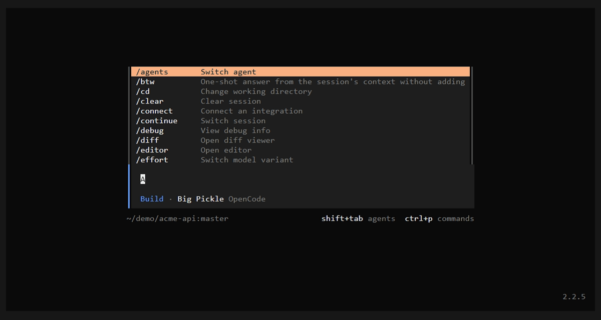

# opencode-mkdir

A plugin for the [OpenCode](https://opencode.ai) TUI (v2) that adds `/mkdir`: create a folder in the current
directory and move the session into it, without leaving the prompt.

> Supports OpenCode V2 only (built against `@opencode/plugin` 2.2.5). V1 is not supported.

<p align="center">
  
</p>

The demo shows `/mkdir web-app` on the Home screen, which opens a new session in the new folder, then `/md` without a
name inside that session, which asks for one and moves the session into `notes`.

## Features

- **One command, two steps.** Creates the folder and moves the current session into it with `session.move`. On the
  Home screen, it opens a new session there instead.
- **Nested paths and spaces.** `/mkdir a/b/c` creates every missing level; `/mkdir "My Folder"` keeps the space.
- **Safe by default.** The folder must be inside the current directory: absolute paths and `..` are rejected, and an
  existing folder or file is never touched.
- **Works without a name.** Run it with no argument, or from the command palette, and it asks for one.
- **Local only.** Nothing is sent to the model, and the plugin makes no network requests.

## Requirements

- OpenCode V2 2.2.5 or newer, on Windows, macOS or Linux.

## Install

Install the plugin from GitHub with the OpenCode CLI. Pin a release tag: OpenCode then caches that exact version and
can tell when a newer one is out.

```sh
opencode plugin add github:igorovh/opencode-mkdir#v0.2.0
```

The plugin only has a TUI part, so this adds it to the `plugins` array in `~/.config/opencode/cli.json`. Restart the
TUI, then run `/mkdir`.

You can also add the entry to that file yourself:

```jsonc
{
  "$schema": "https://opencode.ai/v2/cli.json",
  "plugins": ["github:igorovh/opencode-mkdir#v0.2.0"]
}
```

Update or remove it later:

```sh
opencode plugin update github:igorovh/opencode-mkdir#v0.2.0
opencode plugin remove github:igorovh/opencode-mkdir#v0.2.0
```

## Commands

| Slash command | Action |
|---|---|
| `/mkdir <name>` | Create `<name>` in the current directory and move the session there |
| `/newdir <name>`, `/md <name>` | Same as `/mkdir` |
| `/mkdir` (no name) | Ask for the name first |
| Palette (`Ctrl+P`): *Create folder and move into it* | Same as `/mkdir` with no name |

The plugin has no options.

## How it works

The folder is created relative to the directory of the session you are looking at, or the current project on the
Home screen. The name is resolved inside that directory; anything that would land outside it is rejected before
anything is written.

- **In a session**, the plugin calls `session.move`, so the session keeps its history and continues in the new folder.
- **On the Home screen**, it creates a new session in the new folder and opens it.
- If the folder is created but the move fails, the folder stays and a toast says why.

## Development

Requires [Bun](https://bun.sh).

```sh
git clone https://github.com/igorovh/opencode-mkdir.git
cd opencode-mkdir
bun install
bun test
bun run typecheck
```

To run your checkout instead of the published plugin, put its path in `plugins` and restart the TUI. After that,
OpenCode reloads the plugin whenever a file changes.

```jsonc
{
  "plugins": ["/path/to/opencode-mkdir"]
}
```

To record the demo again, install [VHS](https://github.com/charmbracelet/vhs) and run `vhs docs/demo.tape`. The
tape's header lists the environment variables it reads.

## License

[MIT](LICENSE)
